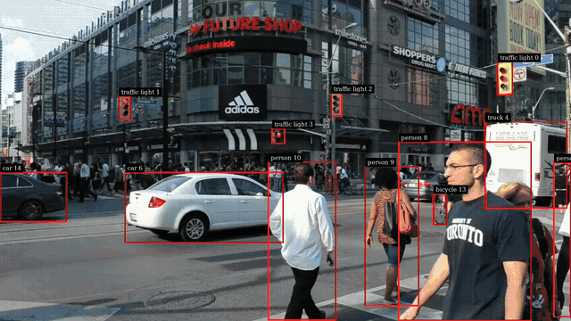

# Redstream

**GStreamer video and audio analytics on AMD GPUs: an open-source, ROCm-based functional equivalent of NVIDIA DeepStream.**

> Status: **pre-alpha.** The first milestone's pipeline runs end to end on an AMD GPU: decode → batch → detect →
> track → tile → on-screen display → window, from files or RTSP streams, with the core library `libgstrds`, eleven
> elements (`rdsurisrcbin`, `rdsvideodec`, `rdsvideoconvert`, `rdsstreammux`, `rdsstreamdemux`, `rdsinfer`,
> `rdstracker`, `rdsmultistreamtiler`, `rdsosd`, `rdslogger`, `rdsvideosink`) and the `rds-compile` tool (see "What
> works" below). APIs and element names will change.



*A 720p street clip (CC0, Wikimedia Commons) through `rdsvideodec` → `rdsstreammux` → `rdsinfer` (YOLO11n) →
`rdstracker` (NvSORT) → `rdsosd` → `rdsvideosink` on a Ryzen 7000 iGPU; the command is under "See it" below.*

## Why

NVIDIA DeepStream is the de-facto toolkit for multi-stream video analytics pipelines, but it only runs
on NVIDIA hardware. AMD GPUs and APUs have capable video engines (VCN) and a maturing compute stack (ROCm,
HIP, MIGraphX), but there is no equivalent end-to-end analytics framework.

Upstream GStreamer has recently gained many of the building blocks: VA-API decode, a HIP plugin,
analytics metadata, tensor decoders and batching. What's missing is the AMD-specific glue
(zero-copy decode→GPU, GPU-resident batching, a MIGraphX inference element) and a DeepStream-compatible
surface so existing applications can move over without a rewrite.

## Goals

- **Functional parity** with the core of DeepStream: multi-stream decode, batching, primary and secondary
  inference, tracking, on-screen display, analytics, encode, and audio inference.
- **Easy porting.** An existing DeepStream app should port with only small, mechanical changes:
  - element names swapped behind an `#ifdef`
  - the same `nvinfer` / `nvstreammux` / tracker config files
  - the same metadata-traversal code through a compatibility header
- **GPU-resident pipelines.** Frames stay in GPU memory from decode to inference.
- **Upstream-friendly.** Built on GStreamer 1.28+ and GstAnalytics. Generic pieces are contributed upstream.

Non-goals (for now): binary compatibility with DeepStream, Triton (`nvinferserver`), TAO encrypted models,
Jetson-specific hardware blocks.

## What works

- **`libgstrds`:** batched GPU surfaces (`RdsBufSurface`, the `memory:RDS` caps feature), buffer pools,
  DeepStream-shaped metadata (batch, frame, object, user and display meta) and stream events.
- **`rds_buf_surf_transform`:** batched crop, scale (nearest, bilinear) and colour conversion between NV12, I420,
  RGBA, BGRA, RGBx, BGRx, RGB, BGR and GRAY8 on the GPU, shaped like `NvBufSurfTransform`; and
  `rds_buf_surf_transform_composite`, many surfaces into one (`NvBufSurfTransformComposite`).
- **`rdsurisrcbin`** (`nvurisrcbin`): a source bin for file and RTSP URIs, decoded with `rdsvideodec` to
  `memory:RDS` NV12 on `vsrc_0`, with `nvurisrcbin`'s properties: `file-loop`, `drop-frame-interval`, RTSP latency
  and transport, and reconnection (`rtsp-reconnect-interval`, `rtsp-reconnect-attempts`,
  `init-rtsp-reconnect-interval`). An RTSP source that stalls, drops the connection or refuses it is reconnected
  without ending the stream (same pad, running time going on), also when it comes back at another size or in another
  codec; the reconnection messages are DeepStream 8.0's, plus a few of ours. Tested against gst-rtsp-server (with a
  fault relay), not yet against real cameras.
- **`rdsvideodec`** (`nvv4l2decoder`): H.264 and H.265 (8-bit 4:2:0) decoding with rocDecode into `memory:RDS` NV12,
  bit-exact with the stock VA decoders. It ranks above them, so `uridecodebin` picks it; it falls back to system
  memory for ordinary sinks.
- **`rdsvideoconvert`** (`nvvideoconvert`): conversion, scaling and cropping between `memory:RDS` and system memory,
  with `nvvideoconvert`'s property names.
- **`rdsstreammux`** (`nvstreammux`, the default mux): batches frames from any number of sources into one
  `memory:RDS` buffer, each frame scaled into a fixed `width`×`height` slot (optionally with aspect-ratio padding),
  with per-frame metadata, `batched-push-timeout`, live sources, DeepStream's stream events (pad added/deleted,
  per-stream EOS, …) and sources added or removed while playing. The zero-copy "new" mux and its config file are not
  implemented yet.
- **`rdsstreamdemux`** (`nvstreamdemux`): splits a batch back into per-source streams without copying: each output
  buffer is a read-only view of its slot (a writer gets its own copy), with the source's own timestamps, segment and
  stream events.
- **`rdsinfer`** (`nvinfer`): a primary detector on MIGraphX. It reads nvinfer config files (key file or YAML),
  runs ONNX models (YOLO11n tested) on whole batches on the GPU, and attaches object meta and, optionally, tensor
  output meta. Bounding boxes come from the built-in YOLO parser or from a DeepStream custom bbox parser library,
  recompiled against `rds/rds_compat_infer.h`. Secondary mode and classifiers are not implemented yet.
- **`rdstracker`** (`nvtracker`): gives detected objects persistent IDs with the IOU and NvSORT trackers of
  NvMultiObjectTracker, on the CPU, reading the same YAML low-level config files (NvDCF and NvDeepSORT configs run
  as NvSORT). Where NVIDIA's docs leave behaviour open, it follows observed DeepStream 8.0 behaviour, and the compat
  matrix lists every point where it differs. Our own tuned configs are in `samples/tracker/`.
- **`rdsmultistreamtiler`** (`nvmultistreamtiler`): composes a batch into one rows × columns frame on the GPU and
  merges the sources' metadata into it, scaled into the tiles, as DeepStream 8.0 does; `show-source` shows one
  source alone.
- **`rdsosd`** (`nvdsosd`): draws object boxes and labels, and display meta (rectangles, text, lines, arrows,
  circles) and the clock, in the geometry of DeepStream 8.0's GPU mode. It draws on the GPU by default, so frames
  never leave it, or on the CPU with `process-mode=0`, the same pixels either way (Pango renders the text). Masks
  and blur are not drawn yet.
- **`rdslogger`** (`nvdslogger`): prints each stream's frame rate in DeepStream's `**PERF` line format.
- **`rdsvideosink`** (`nveglglessink`, `nv3dsink`): shows frames in a window through a stock GStreamer sink
  (`autovideosink` by default), with the DeepStream sinks' property names.
- **`rds-compile`** (`trtexec`): compiles and caches `rdsinfer`'s MIGraphX program ahead of time.
- **Compat header** `rds/rds_compat.h`: DeepStream names for the above, plus runtime remapping of element names
  (`nvurisrcbin` → `rdsurisrcbin`, `nvv4l2decoder` → `rdsvideodec`, `nvstreammux` → `rdsstreammux`, `nvinfer` →
  `rdsinfer`, `nvtracker` → `rdstracker`, `nvdsosd` → `rdsosd`, …).

[`docs/compat-matrix.md`](docs/compat-matrix.md) lists every mapped name and property with its status. Built from
this repository (see "Getting started"; `tests/media/make-test-media.sh` generates the clips), a decode and convert
pipeline looks like this:

```bash
GST_PLUGIN_PATH_1_0=build/gst gst-launch-1.0 filesrc location=.cache/media/ball-720p.h264 ! h264parse ! rdsvideodec \
  ! rdsvideoconvert ! "video/x-raw(memory:RDS),format=RGBA,width=640,height=640" ! fakesink sync=false
```

Two sources batched on the GPU and split again, one `queue` per output branch:

```bash
GST_PLUGIN_PATH_1_0=build/gst gst-launch-1.0 rdsstreammux name=m batch-size=2 width=1280 height=720 \
  ! rdsstreamdemux name=d \
  filesrc location=.cache/media/ball-720p.h264 ! h264parse ! rdsvideodec ! m.sink_0 \
  filesrc location=.cache/media/smpte-1366x768.h264 ! h264parse ! rdsvideodec ! m.sink_1 \
  d.src_0 ! queue ! fakesink sync=false  d.src_1 ! queue ! fakesink sync=false
```

Two sources batched and run through YOLO11n. Fetch the model first (see "Getting started"); the first run compiles
it for batch 2, which takes a minute or two on a small GPU, and later runs load the cached program.
`GST_DEBUG=rdsinfer:5` logs the number of objects in each frame:

```bash
GST_PLUGIN_PATH_1_0=build/gst GST_DEBUG=rdsinfer:5 gst-launch-1.0 rdsstreammux name=m batch-size=2 width=1280 \
  height=720 ! rdsinfer config-file-path=samples/rds-test3/rds_test3_pgie_config.yml batch-size=2 ! fakesink sync=false \
  filesrc location=.cache/media/ball-720p.h264 ! h264parse ! rdsvideodec ! m.sink_0 \
  filesrc location=.cache/media/smpte-1366x768.h264 ! h264parse ! rdsvideodec ! m.sink_1
```

The generated test clips (a bouncing ball, SMPTE bars) contain nothing YOLO11n detects, so expect 0 objects per
frame: this checks that the pipeline runs, not what it finds.

### See it

Fetch YOLO11n and the street clip (see "Getting started"). The `rds-test3` sample is shaped like DeepStream's
`deepstream-test3`: N sources → `rdsstreammux` → `rdsinfer` → `rdstracker` → `rdsmultistreamtiler` →
`rdsvideoconvert` → `rdsosd` → `rdsvideosink`. It prints each source's object counts per frame and shows the sources
tiled, with boxes and track IDs, in a window:

```bash
GST_PLUGIN_PATH_1_0=build/gst build/samples/rds-test3/rds-test3 \
  --tracker-config samples/tracker/config_tracker_NvSORT.yml \
  file://$PWD/.cache/media/crosswalk-720p.h264 file://$PWD/.cache/media/crosswalk-720p.h264
```

`--no-display` runs to a fakesink as fast as it can; `GST_DEBUG=rdstracker:5` adds the tracker's per-frame log.
From the dev container, a window needs the X11 socket and credentials; add these to `docker run`:

```bash
-e DISPLAY -v /tmp/.X11-unix:/tmp/.X11-unix -e XAUTHORITY=/tmp/.xauth -v $XAUTHORITY:/tmp/.xauth:ro
```

One source through the whole chain with `gst-launch-1.0` (`sync=false`: a raw `.h264` file has no timestamps, so a
synchronizing sink would drop most frames):

```bash
GST_PLUGIN_PATH_1_0=build/gst gst-launch-1.0 filesrc location=.cache/media/crosswalk-720p.h264 ! h264parse \
  ! rdsvideodec ! m.sink_0 rdsstreammux name=m batch-size=1 width=1280 height=720 \
  ! rdsinfer config-file-path=samples/rds-test3/rds_test3_pgie_config.yml batch-size=1 \
  ! rdstracker ll-config-file=samples/tracker/config_tracker_NvSORT.yml \
  ! rdsvideoconvert ! "video/x-raw(memory:RDS),format=RGBA" ! rdsosd ! rdsvideosink sync=false
```

On that clip (56 s of a busy crosswalk, YOLO11n detections) the NvSORT sample config keeps 98.8 % of the confident
detections tracked, with 4 ID switches over 283 tracks; the tracker itself takes about 0.01 ms per batch on the CPU.
Four copies of the clip through the whole `rds-test3` chain run at about 44–46 fps on the iGPU below (`--no-display`):
the detector sets the pace, and the tiler and OSD add about 2.5 ms per batch (2.1 ms tiling, 0.4 ms drawing; release
build).

## How it maps to DeepStream

| DeepStream | Redstream | Status |
|---|---|---|
| `nvv4l2decoder` | `rdsvideodec` (rocDecode) | works |
| `nvurisrcbin` | `rdsurisrcbin` | works (file and RTSP URIs, RTSP reconnection) |
| `nvvideoconvert` | `rdsvideoconvert` | works |
| `nvstreammux` / `nvstreamdemux` | `rdsstreammux` / `rdsstreamdemux` | works (video; the default, scaling mux. DeepStream's zero-copy "new mux" mode is planned) |
| `nvinfer` | `rdsinfer` (MIGraphX) | works (primary detector) |
| `nvtracker` | `rdstracker` | works (IOU, NvSORT) |
| `nvdsosd` | `rdsosd` | works |
| `nvmultistreamtiler` | `rdsmultistreamtiler` | works |
| `nvdsanalytics` | `rdsanalytics` | planned |
| `nveglglessink`, `nv3dsink` | `rdsvideosink` | works |
| `nvdslogger` | `rdslogger` | works |
| `nvv4l2h264enc`, `nvv4l2h265enc` | `rdsh264enc`, `rdsh265enc` | planned |
| Audio batching in `nvstreammux` / `nvstreamdemux` | audio in `rdsstreammux` / `rdsstreamdemux` | planned |
| `nvinferaudio` | `rdsinferaudio` (MIGraphX) | planned |
| `nvdsaudiotemplate` | `rdsaudiotemplate` | planned |
| `NvDsBatchMeta`, `NvDsObjectMeta`, … | `Rds*` + `rds/rds_compat.h` | works |
| TensorRT `.engine` | MIGraphX `.mxr` (compiled from ONNX, cached) | works |

## Roadmap

**M1: multi-stream detector**
- File/RTSP sources → rocDecode decode (`rdsvideodec`) → `rdsstreammux` → `rdsinfer` (YOLO + custom bbox parser) → `rdstracker` → `rdsosd`.
- Done: the pipeline runs end to end from files and RTSP streams (with reconnection; tested against gst-rtsp-server),
  with tiling, on-screen display and a display sink. Left: the ported `deepstream-test3`.
- Acceptance test: NVIDIA's `deepstream-test3` sample, ported with `#ifdef`s only, produces equivalent detections.

**M2: production-style multi-model pipeline**
- Pose detector with keypoints.
- Secondary models on object crops, with raw tensor output (ReID embeddings, attribute classifiers).
- Metadata edits in pad probes.
- ROI and line-crossing analytics, and an H.264 recording branch.

**Later: audio analytics**
- Audio streams batched by `rdsstreammux` and split again by `rdsstreamdemux`, as DeepStream's new mux does.
- `rdsinferaudio` (`nvinferaudio`): audio classification on MIGraphX, with the log-mel spectrogram front end on the
  GPU, and the same config files.
- The audio batch buffer and its metadata (frame and classifier meta), and `rdsaudiotemplate` for custom audio
  processing libraries.

## Hardware

Only one GPU has been tested so far: the RDNA2 iGPU of a Ryzen 7000 desktop CPU (gfx1036). Other ROCm-capable GPUs
with a VCN video engine (Radeon RDNA2/3/4, Ryzen AI APUs such as Strix Point and Strix Halo) are expected to work,
but are untested; reports, good or bad, are welcome in the issues. Some Instinct SKUs lack video decode engines.

Early numbers on a 2-CU Ryzen 9 7900X iGPU:
- VA-API H.264 1080p decode: about 600 fps.
- YOLO11n 640×640 FP16 via MIGraphX: about 60 inferences/s.
- `rdsinfer` with YOLO11n FP32, four 720p sources at batch 4 (decode, batching, inference and post-processing):
  about 50 fps; about 48 fps with `rdstracker` (NvSORT) after it; about 44–46 fps through the whole `rds-test3`
  chain (tracker, tiler and OSD, to a fakesink).
- `rdsosd` at 1280×720 with about 60 objects, release build: about 0.3 ms per frame on the GPU (about 1.2 ms with
  `process-mode=0`, the CPU drawing and the GPU↔CPU syncs included). On 1920×1080 frames from `rdsstreamdemux`,
  which it draws on a private copy: about 0.9 ms on the GPU, about 7 ms on the CPU (the copy's CPU staging).

**Known issue (ROCm 10.1):** with more HIP streams than hardware queues, which a multi-stream pipeline easily has,
an SDMA copy can occasionally fault and abort the process with `Memory access fault by GPU ... on address 0x401000`.
Set `HSA_ENABLE_SDMA=0` to have copies done by blit kernels instead; on the gfx1036 iGPU this costs nothing
measurable (about 44 fps for `rds-test3` either way). Raising `GPU_MAX_HW_QUEUES` also avoids it but costs
throughput (about 29 fps with 16 queues). The test suite sets `HSA_ENABLE_SDMA=0`.

## Getting started (development)

Requirements: Linux with the `amdgpu` kernel driver (`/dev/kfd` and `/dev/dri/renderD*` present), Docker.

```bash
docker build -f docker/Dockerfile.dev -t redstream:dev .
docker run -it --rm --device=/dev/kfd --device=/dev/dri \
  --group-add $(getent group render | cut -d: -f3) --group-add $(getent group video | cut -d: -f3) \
  --security-opt seccomp=unconfined -v "$PWD":/src -w /src redstream:dev

# inside the container: check that the GPU and the video engine are visible
rocminfo | grep gfx
vainfo --display drm --device /dev/dri/renderD128
```

Build and run the tests (inside the container):

```bash
meson setup build && meson test -C build --print-errorlogs
```

Then a first check with Redstream's own elements, on a clip generated with the VA encoder: decode with rocDecode and
convert to RGBA on the GPU.

```bash
tests/media/make-test-media.sh   # writes .cache/media/*.h264
GST_PLUGIN_PATH_1_0=build/gst gst-inspect-1.0 rdsvideodec
GST_PLUGIN_PATH_1_0=build/gst gst-launch-1.0 filesrc location=.cache/media/ball-720p.h264 ! h264parse ! rdsvideodec \
  ! rdsvideoconvert ! "video/x-raw(memory:RDS),format=RGBA,width=640,height=640" ! fakesink sync=false
```

The YOLO11n tests and the detector example need the model, exported on your machine (on the host: it needs Docker
and network access). YOLO11n is AGPL-3.0, so it goes into the git-ignored `.cache/models/` and is never committed;
the tests that need it skip without it. See [`tests/models/README.md`](tests/models/README.md).

```bash
tests/models/fetch-yolo11n.sh
```

The tracker tests and the tracking example use a public-domain (CC0) street clip from Wikimedia Commons, transcoded
to 720p H.264 on your machine (on the host: it needs Docker, network access and the GPU). It goes into the
git-ignored `.cache/media/` and is never committed; the tests that need it skip without it.

```bash
tests/models/fetch-tracker-clip.sh
```

More tools from the build tree:

RTSP: `rds-rtsp-serve` serves a test pattern over RTSP, with a fault relay in front of it (here the connection is cut
10 s in); `rds-test3` reconnects to it (`rtsp-reconnect-interval` 2) and prints the reconnection as it goes. Only
RTSP over TCP goes through the relay, hence `--select-rtp-protocol 4`. `rds-test3`'s default detector is YOLO11n
(`tests/models/fetch-yolo11n.sh`). Ctrl-C stops `rds-test3`; `kill %1` then stops the server.

```bash
build/tools/rds-rtsp-serve/rds-rtsp-serve --proxy-port 8555 --faults 10:cut &   # rtsp://127.0.0.1:8555/test
GST_PLUGIN_PATH_1_0=build/gst build/samples/rds-test3/rds-test3 --no-display --rtsp-reconnect-interval 2 \
  --select-rtp-protocol 4 rtsp://127.0.0.1:8555/test rtsp://127.0.0.1:8554/test
kill %1
```

```bash
build/samples/rds-test3/rds-test3 --dry-run file:///a.mp4   # shows the DeepStream → Redstream element mapping
build/tools/rds-compile -c config.txt   # pre-builds rdsinfer's MIGraphX program, like trtexec (docs/compat-matrix.md)
```

The image targets RDNA2 APUs by default (`HSA_OVERRIDE_GFX_VERSION=10.3.0`, `--build-arg GFX=gfx1030`).
On other GPUs, pass your gfx target and unset the override.

## Contributing

Redstream is pre-alpha, and issues and pull requests are welcome: bug reports, results on GPUs we have not tested,
DeepStream behaviour we get wrong, and fixes or new elements. For anything large, open an issue first so the design
can be discussed there. [`CONTRIBUTING.md`](CONTRIBUTING.md) has the ground rules; if you use AI coding agents, read
[`AGENTS.md`](AGENTS.md) first.

This is a clean-room implementation: do not contribute code, headers or documentation copied from the
NVIDIA DeepStream SDK. Commits are signed off under the Developer Certificate of Origin; see
[`CONTRIBUTING.md`](CONTRIBUTING.md).

## License

The libraries, plugins, tools and tests are licensed under the GNU Lesser General Public License, version 2.1 or
(at your option) any later version ([`LICENSE`](LICENSE)), as GStreamer is. Applications that use Redstream through
its shared libraries and plugins may have any licence; changes to Redstream itself that you distribute must be
published under the same terms.

The samples in [`samples/`](samples) (code and configs) are under the MIT licence ([`samples/LICENSE`](samples/LICENSE)),
so you can copy them into your own applications freely.

Each source file names its licence in an `SPDX-License-Identifier` line. Files without one (the test config fixtures)
are under the LGPL like the rest of the tree outside `samples/`.

## Trademarks

NVIDIA and DeepStream are trademarks of NVIDIA Corporation. AMD, ROCm and Radeon are trademarks of Advanced
Micro Devices, Inc. This project is not affiliated with or endorsed by either company.
